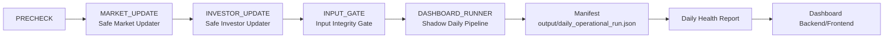

# BAIKAL Stock Signal
## Daily Operations Manual v1.0
### Dashboard STEP 6 Baseline

### STEP 39: 후속 운영 재개 안전장치 (격리 검증 전용)

이 구현은 운영 승인이나 Scheduler 활성화를 의미하지 않는다. Daily/DUAL은 재가동하지 않는다.

- 날짜 예외와 READY 가져오기 승인은 분리한다. 날짜 예외는 **2026-11-09
  PARTIAL_UNRECOVERED**를 완료·READY·성과로 변경하지 않고 11/10 이후 날짜 게이트만
  통과시킨다. 다른 미완료 날짜는 계속 차단한다.
- 예외 기록은 `output/expanded_shadow/continuation_exception.json`이며
  `BAIKAL_EXPANDED_CONTINUATION_APPROVAL_SHA256`의 독립적인 SHA256 고정값이 필요하다.
  날짜·범위·승인자·승인 참조·시간대 포함 시각·사유·코드 출처 SHA·실행 구현의
  `implementation_sha256`·원본 PARTIAL manifest/signals 증거 목록을 검증한다.
  승인 파일이나 증거가 누락·변경되면 실행과 관련 조회를 차단한다.
- `implementation_sha256()`은 Expanded Python 모듈·CLI·Dashboard 조회 코드의 실제
  파일 해시를 묶는다. `code_sha`는 출처 Git SHA이고, 미커밋 구현을 포함한 실행 파일의
  동일성은 별도 구현 해시로 확인한다. 코드 변경 후 기존 승인을 재사용하지 않는다.
- 별도 CLI는 `python -B -m scripts.expanded_ready_import`이다.
  `plan --source <격리결과루트> --destination <대상루트>`는 파일을 쓰지 않고
  원본 증거/입력 목록, 대상 파일별 before/after 해시, 쓰기 집합 해시를 출력한다.
  원본의 `PROHIBITED_BY_OPERATOR`는 수정하지 않는다.
- `apply`는 같은 source/destination과 별도
  `--approval <승인기록> --approval-sha256 <독립고정값>`이 필요하다.
  승인 종류는 `IMPORT_ISOLATED_READY`, 운영 게시만 허용하고 성과 갱신은 금지한다.
  계획의 모든 필드와 source_inventory를 승인에 포함해야 한다. 신호 원장,
  Registry, 날짜별 불변 manifest/latest, current 및 필요한 당일 입력만 대상이다.
  수집·재분석·성과 계산을 호출하지 않는다.
- 쓰기 전 `output/expanded_shadow/publication_transaction/active.json`에 승인 원문,
  정확한 쓰기 집합, 원래 소유 PID와 단계를 영속 기록하고 백업/새 파일 해시를 검증한다.
  중단 시 자동으로 정상 READY를 반환하지 않는다. 관련 API는 503으로 차단하며
  조회 도중 게시 상태가 바뀐 경우도 재조회가 필요하다. 화면 새로고침 실패 시
  이전 READY 행을 제거한다.
- 중단된 가져오기는 `recover --destination <대상루트> --approval-sha256 <동일고정값>`으로
  명시적으로 복구한다. 살아 있는 소유자, 다른 잠금, 승인·백업 변조, 외부 대상 변경은
  차단한다. 복구 자체가 중단되어도 같은 명령으로 이어서 원래 바이트를 복원한다.
  완전한 초기 journal 임시 파일은 검증 후 복구하지만, 완전한 journal도 없는 디렉터리는
  추측해서 삭제하거나 정상 처리하지 않고 점검 대상으로 차단한다.
- 복구/게시 완료 후 `archive`는 같은 destination/pin으로 최종 해시를 확인하고
  journal과 백업을 `publication_archive/`로 이동하여 보존한다. 삭제하지 않는다.
  후속 분석 실행 및 복구 후 재시도는 먼저 명시적 archive가 필요하다.
  재시도는 새 계획도 검증한다. 같은 완료 가져오기의
  재호출은 결과 해시가 일치할 때만 `ALREADY_IMPORTED`이다.
- 이 영속 journal은 **새 READY 가져오기 경로**의 보호 장치다. 기존 일반 분석
  게시 경로를 모두 crash-atomic하게 바꾼 것은 아니다. 자동 운영 재개는 별도 검토·승인
  대상이며, 19:00 입력 확보도 보장하지 않는다.
- 격리 worktree의 기존 로컬 의존 코드와 래퍼도 별도로 재현 가능하게 보존해야 한다.
  날짜 예외 적용, 실제 READY 게시, Scheduler 활성화 및 Git 보존 승인은 각각 별개다.

### STEP 41: STAGING 복구 및 실행 재현성

- 최초 STAGING의 승인 원문·쓰기 집합·before/after SHA-256은 복구 중에도 변경하지 않는다.
  `recovery_origin`은 복구 시작 단계를 보존하는 진행 정보다. STAGING에서 시작한 복구는
  RECOVERING 저장 직후 재중단되어도 같은 승인과 스냅샷으로 재진입할 수 있다.
- 미완성 STAGING에서는 대상이 원래 바이트인 경우에만 아직 없는 staged 파일을 허용한다.
  이미 존재하는 staged/backup 파일은 원래 해시와 반드시 일치해야 한다. 변조나 외부 쓰기는
  복구를 차단하며 조회 차단 상태도 유지한다. `recover` CLI는 실패 시 종료 코드 1과
  `SAFETY_STOP` JSON 오류를 출력한다. 해시 재작성으로 복구하지 않는다.
- 저장소 루트의 `run_expanded_with_log.ps1`은 `$PSScriptRoot`를 기준으로
  `.venv\Scripts\python.exe`와 `output\expanded_scheduler_logs`를 사용한다.
  기존 `-m scripts.expanded_operational_run --json --run-context scheduled` 인수와
  로그 리디렉션·종료 코드 전달을 유지한다. 별도 위치에 복사된 래퍼는 그 위치의
  저장소·가상환경을 실행하므로 운영 위치로의 적용과 Scheduler 변경은 별도 승인 대상이다.
- STEP 39의 16개 파일만으로 원격 main의 운영 의존성이 재현되는 것은 아니다.
  로컬 운영 경계·Universe 인터페이스 의존 코드를 함께 식별해야 하며, 원격 고정 574
  계약을 통과시키기 위해 기존 로컬 종목 선정 규칙을 되돌리거나 완화하지 않는다.
- 실행 식별은 Git HEAD뿐 아니라 미커밋 파일별 SHA-256, 실제 Python·의존성 버전,
  진입점·인수·작업 디렉터리와 Universe 원본 바이트 SHA-256을 함께 사용한다.
  종목 목록의 논리적 동일성은 CRLF/LF 등 바이트 차이를 대체하지 않는다.
  정확한 Universe 바이트나 실행 환경이 일치하지 않으면 운영 적용은 BLOCKED다.

> 이 문서는 2026-09-04 기준, HEAD/origin/main = `0b2958f77e57301b38a657d14dc1d346b6aa0f96` (main, Working Tree clean) 코드를 실제로 조사하여 작성했다.
> 존재하지 않는 명령/기능은 기재하지 않았으며, 모든 명령은 repository 내 실제 코드(`scripts/`, `dashboard/`, `src/`, `tests/`)를 근거로 한다.

---

## 0. 용어

| 용어 | 실제 코드 위치 |
|------|----------------|
| Daily Operational Orchestrator | [scripts/daily_operational_run.py](../scripts/daily_operational_run.py) `run_daily_operation()` |
| Safe Market Updater | [scripts/safe_market_update.py](../scripts/safe_market_update.py) `SafeMarketUpdater` |
| Safe Investor Updater | [scripts/safe_investor_update.py](../scripts/safe_investor_update.py) `SafeInvestorUpdater` |
| Input Integrity Gate | [scripts/input_integrity_gate.py](../scripts/input_integrity_gate.py) `run_input_integrity_gate()` |
| Dashboard Runner (Shadow Pipeline 실행) | [dashboard/runner/shadow_dashboard_runner.py](../dashboard/runner/shadow_dashboard_runner.py) `run_dashboard_pipeline()` |
| Daily Health / Exception Report | [scripts/daily_health_report.py](../scripts/daily_health_report.py) `build_report()` |
| Dashboard Backend API | [dashboard/api.py](../dashboard/api.py) |
| Dashboard Frontend | [dashboard/frontend/](../dashboard/frontend/) (Vite + React) |

---

## 1. 시스템 운영 구조 (실제 코드 흐름)

`daily_operational_run.py`의 `run_daily_operation()`은 다음 순서로 5개 Phase를 실행한다 (`PRECHECK → MARKET_UPDATE → INVESTOR_UPDATE → INPUT_GATE → DASHBOARD_RUNNER`).



각 Phase 실패 시 이후 Phase는 실행되지 않고 즉시 중단된다 (stop-on-fail).

- **DASHBOARD_RUNNER** 내부에서 실제로 실행되는 것은 `scripts/shadow_daily_pipeline.py`의 Shadow Daily Pipeline이다 (STEP2 daily scan → STEP3 forward return update → STEP4 benchmark update → STEP5 performance report, 4단계 순차 실행, phase별 PASS/FAIL 격리).
- **주의**: 사용자 안내문의 "Signal / Shadow / Validation" 개념 흐름 중, 실제 구현에서 하나로 통합되어 있는 것은 "Shadow Daily Pipeline" 뿐이다. `python -m src.main` (README에 기술된 baseline signal 생성 스크립트, `output/signals.csv`/`output/summary.csv` 생성)은 Daily Operational Orchestrator에 포함되어 있지 않다. 즉 **Daily Run에서 자동으로 실행되는 것은 Shadow Pipeline이며, `src.main`은 별도 수동 실행 대상**이다.
- 모든 결과는 `output/daily_operational_run.json`에 원자적(atomic write, temp file + fsync + os.replace)으로 기록된다.
- 동시 실행 방지를 위해 `output/daily_operational_run.lock` 파일 기반 lock을 사용한다 (12시간 경과 시 stale lock 자동 해제).

---

## 2. 최초 실행 준비 (Windows PowerShell)

### 2-1. 프로젝트 디렉터리 이동
```powershell
cd C:\baikal777\baikal-stock-signal-backtest
```

### 2-2. Python 가상환경
```powershell
python -m venv .venv
Set-ExecutionPolicy -Scope Process -ExecutionPolicy RemoteSigned
.\.venv\Scripts\Activate.ps1
```

### 2-3. Python dependency 설치
```powershell
pip install -r requirements.txt
```
[requirements.txt](../requirements.txt) 기준: `pandas`, `numpy`, `pytest`, `finance-datareader`, `requests`, `lxml`, `OpenDartReader`.

### 2-4. Frontend dependency 설치
```powershell
cd dashboard\frontend
npm install
cd ..\..
```

### 2-5. 환경변수
조사 결과, STEP 6 Daily Operations 실행에 필요한 환경변수는 **없다**. (`scripts/safe_market_update.py`, `scripts/safe_investor_update.py`, `scripts/daily_operational_run.py`, `scripts/input_integrity_gate.py`, `dashboard/` 전체에서 `os.environ` / API Key 참조 없음.)
> `OpenDartReader`는 requirements에 있지만 STEP6 Daily 흐름(orchestrator)에서 사용되지 않는다 — 기업 재무데이터(fundamental) 관련 별도 step 스크립트(`scripts/step10_fundamental_feasibility.py` 등) 전용이다.

### 2-6. Backend 실행 확인 (1회성 점검)
```powershell
python -m dashboard.api
```
→ `http://127.0.0.1:8765` 에서 API 서버가 뜬다 (Ctrl+C로 종료).

### 2-7. Frontend 실행 확인 (1회성 점검)
```powershell
cd dashboard\frontend
npm run dev
```
→ `http://localhost:5173` 접속 확인 후 Ctrl+C로 종료.

---

## 3. 정상 일일 운영 절차

### STEP A — Daily Operational Run 실행

**[목적]** Market Update → Investor Update → Input Integrity Gate → Shadow Daily Pipeline을 한 번에 순차 실행한다.

**[실제 실행 명령]**
```powershell
cd C:\baikal777\baikal-stock-signal-backtest
.\.venv\Scripts\Activate.ps1
python -m scripts.daily_operational_run --json
```
**주의**: `python scripts\daily_operational_run.py --json`처럼 파일 경로로 직접 실행하면 `ModuleNotFoundError: No module named 'dashboard'`가 발생한다. `scripts/`와 `dashboard/`가 모두 repository root 기준 패키지이므로 반드시 `-m` 모듈 방식으로 실행한다.

**[정상 결과]**
- 종료 코드 0
- 콘솔에 JSON 출력, `overall_status`가 `SUCCESS` 또는 `SUCCESS_WITH_WARNING`

**[확인할 파일/화면]**
- [output/daily_operational_run.json](../output/daily_operational_run.json) — 이번 실행의 전체 manifest (phases 배열 포함)

**[실패 시 다음 행동]**
- 종료 코드 1 또는 `overall_status: FAILED` → 7장 "장애 대응" 참조. 원인 파악 전 재실행 금지.

### STEP B — Daily Health / Exception Report 확인

**[목적]** 방금 생성된 manifest를 읽기 전용으로 해석하여 운영자가 판단하기 쉬운 리포트를 생성한다.

**[실제 실행 명령]**
```powershell
python scripts\daily_health_report.py
```
JSON 형식이 필요하면:
```powershell
python scripts\daily_health_report.py --json
```

**[정상 결과]**
- 종료 코드 0, `HEALTH: HEALTHY` 또는 `HEALTH: WARNING`

**[확인할 파일/화면]**
- 콘솔 출력 (`=== DAILY HEALTH REPORT ===` 블록). 별도 파일로 저장되지 않는다 (manifest를 매번 읽어 즉석 생성).

**[실패 시 다음 행동]**
- `HEALTH: FAILED` 또는 종료 코드 1 → 리포트의 `ACTION:` 줄에 제시된 조치를 따른다.

### STEP C — Dashboard 실행 (STEP 5 절 참조)

Daily Run과 Health Report 확인 후, 필요 시 Dashboard backend/frontend를 실행하여 시각적으로 재확인한다 (5장 참조).

---

## 4. Daily Run 완료 후 확인

`output/daily_operational_run.json`(manifest)과 `python scripts\daily_health_report.py` 출력을 기준으로 판단한다.

| 항목 | 확인 위치 | 정상 판단 기준 |
|------|-----------|----------------|
| 거래일 | Health Report의 `RUN DATE` | `(TODAY)` 표시, `PREVIOUS_RUN`이면 오늘 실행분이 아님 |
| Market Update | manifest `market_update_status` | `UPDATED` 또는 `NO_NEW_DATA` (실패는 `FAILED`) |
| Investor Update | manifest `investor_update_status` | `UPDATED` / `NO_NEW_DATA` / `SOURCE_LAG` (실패는 `FAILED`) |
| Integrity Gate | manifest `gate_status`, `pipeline_allowed` | `PASS` 또는 `PASS_WITH_WARNING`, `pipeline_allowed: true` |
| Pipeline (Shadow Daily Pipeline) | manifest `dashboard_status` | `SUCCESS` |
| Signal | manifest `signal_count`, `zero_signal` / [output/shadow_dashboard_run_metadata.json](../output/shadow_dashboard_run_metadata.json)의 `record_count`, `signal_base_date` | `zero_signal: false`이면 신규 signal 존재 (0건도 정상 상태일 수 있음) |
| Shadow | [output/shadow_signal_records.csv](../output/shadow_signal_records.csv) (ledger) | 파일 존재 시 row 수 증가 여부 확인 (현재 baseline은 파일이 아직 없거나 0 records 상태일 수 있으며 이는 정상 — 아직 실거래일 signal 미발생) |
| Validation | [output/shadow_performance_report.md](../output/shadow_performance_report.md) | Shadow Daily Pipeline의 STEP5(performance report) phase가 PASS면 최신 내용으로 갱신됨 |
| Health Report | `python scripts\daily_health_report.py` 콘솔 출력 | `HEALTH: HEALTHY` |
| Exception | Health Report `WARNING:` / `ERROR:` / `ACTION:` 줄 | 없음 = 정상 |

---

## 5. Dashboard 실행 및 확인

### PC 통합 실행 (더블클릭)

- 저장소 루트의 [run_dashboard_board.bat](../run_dashboard_board.bat)을 더블클릭한다.
  기본 주소는 `http://127.0.0.1:5173/`이다. 기존 모바일 실행 helper를 공유하며
  PC는 5173/loopback, 모바일은 기존 5174/LAN 설정을 유지한다.
- 아래의 PARTIAL 사용자 환경변수를 먼저 설정해야 한다. 프로세스에 명시된
  설정을 우선하고, 없으면 저장된 사용자 설정을 불러온다. 경로를 생성하지 않는다.
- API 8765와 frontend 5173의 소유 프로세스·프로젝트 경로·bind 주소를 검사하고
  중단된 서버만 별도 창으로 시작한다. 중복 런처는 잠금으로 차단하며 frontend는
  `--strictPort`로 다른 포트에 자동 기동하지 않는다.
- Expanded GET 준비 상태와 직접/프록시 PARTIAL API의 HTTP 200을 확인한 후
  기본 브라우저를 연다. `MISSING`은 저장 결과 없음으로 경고하며 READY로 표시하지
  않는다. 분석·수집·Scheduler·원장 갱신은 실행하지 않는다.
- 다시 더블클릭하면 정상 서버를 재사용한다. 런처 창을 닫아도 서버는 유지된다.
  종료하려면 이번 런처가 연 각 서비스 창에서 `Ctrl+C`를 누른다. 기존에 다른
  방식으로 실행된 서버는 해당 원래 창/관리 도구에서 식별 후 종료한다.
- 오류 시 창의 원인을 확인한다. 경로 누락/부재는 아래 설정을 바로잡고,
  기존 API가 HTTP 503이면 그 API만 식별해 환경설정을 불러오는 절차로 재시작한다.
  HTTP 422는 입력 검증 실패이므로 경로/근거를 확인하고 데이터는 수정하지 않는다.
  포트 충돌은 자동 종료하지 않는다. 다른 프로세스를 무조건 종료하지 말고,
  동시 실행 잠금은 기존 런처가 끝난 후 재시도한다.

### Backend 실행

Expanded PARTIAL 읽기 전용 조회에는 이미 검증된 격리 collection 루트를
Windows **사용자 환경변수**에 한 번 저장한다. 데이터 복사, 대체 경로 생성,
로컬 절대경로의 Git 기록은 하지 않는다.

```powershell
$partialRoot = Read-Host 'Existing verified isolated collection root'
if (-not [IO.Path]::IsPathRooted($partialRoot) -or
    -not (Test-Path -LiteralPath $partialRoot -PathType Container)) {
    throw 'NO-GO: the verified absolute PARTIAL root must already exist'
}
[Environment]::SetEnvironmentVariable('BAIKAL_EXPANDED_PARTIAL_ROOT', $partialRoot, 'User')
```

`run_dashboard_board.bat`과 `run_mobile_dashboard.bat`은 프로세스에 명시된
설정이 없으면 이 사용자 설정을 다시 읽는다. 설정 저장 전에 열어 둔 터미널도
지원한다. 두 런처 모두 이미 실행 중인 backend의 설정을 바꾸거나 재시작하지
않는다. 설정 변경 후에는 식별된 Dashboard API만 재시작하고 frontend는 유지한다.

backend를 직접 재시작할 때도 저장된 설정을 먼저 명시적으로 불러온다:

```powershell
$env:BAIKAL_EXPANDED_PARTIAL_ROOT = [Environment]::GetEnvironmentVariable('BAIKAL_EXPANDED_PARTIAL_ROOT', 'User')
if (-not $env:BAIKAL_EXPANDED_PARTIAL_ROOT) {
    throw 'NO-GO: BAIKAL_EXPANDED_PARTIAL_ROOT is not configured'
}
.\.venv\Scripts\python.exe -B -m dashboard.api
```

### 격리 READY 조회 (운영 미게시)

검증된 독립 격리 READY만 별도 표시하려면, 이미 존재하는 검증 collection 루트를
`BAIKAL_EXPANDED_ISOLATED_READY_ROOT` **Windows 사용자 환경변수**로 저장한다.
PARTIAL 설정과 별개이며 운영 저장소와 겹치는 경로는 거부한다. 실제 로컬 경로는
Git에 기록하지 않는다. 두 런처의 공유 helper는 프로세스 설정이 없으면 이 사용자
설정을 읽는다. backend 직접 실행 시에도 아래 설정을 먼저 불러온다.

```powershell
$env:BAIKAL_EXPANDED_ISOLATED_READY_ROOT = [Environment]::GetEnvironmentVariable('BAIKAL_EXPANDED_ISOLATED_READY_ROOT', 'User')
```

설정 후 식별된 API만 재시작한다. 조회는
`GET /api/dashboard/expanded-shadow/isolated-ready`이며 Dashboard와 Expanded에서
`격리 READY — 운영 미게시`로 분리된다. PARTIAL·운영 READY·기존 성과는 바뀌지
않는다. 검증 보고서·manifest·universe·입력 해시·신호·저장된 거래상태 근거를
오프라인으로 확인하며 수집·분석·승격·게시를 실행하지 않는다.
미설정은 HTTP 503, 검증 실패는 HTTP 422와 화면 오류로 명시한다.
오류 시 경로와 기존 근거만 확인하고 원본 데이터 보정이나 분석 재실행은 하지 않는다.

- 기본 주소: `http://127.0.0.1:8765`
- 제공 endpoint (모두 GET, read-only): `/api/dashboard/overview`, `/api/dashboard/signals`, `/api/dashboard/health`

`GET /api/dashboard/expanded-shadow/partial`과
`GET /api/dashboard/expanded-shadow/partial-validation`의 HTTP 200을 확인하고,
frontend의 `/expanded-partial`, `/`, `/partial-validation`을 확인한다.
저장 결과만 읽으며 설정 누락을 해결하기 위해 분석을 실행하지 않는다.
HTTP 503은 루트 미설정, HTTP 422는 설정된 입력의 검증 실패를 의미한다.

### Frontend 실행
```powershell
cd dashboard\frontend
npm run dev
```
- 접속 주소: `http://localhost:5173`
- Vite dev server는 `/api` 요청을 `http://127.0.0.1:8765`로 proxy한다 ([vite.config.ts](../dashboard/frontend/vite.config.ts)). **Backend를 먼저 실행한 상태여야** frontend에서 데이터가 표시된다.

### Mobile Pilot (신뢰하는 Private Wi-Fi 전용)

기존 Backend를 PC의 loopback `127.0.0.1:8765`에서 실행한 상태로 유지한다.
별도 frontend 터미널에서 다음 명령을 사용한다. 기존 `npm run dev`는 변경하지 않는다.

```powershell
Set-Location C:\baikal777\baikal-stock-signal-backtest\dashboard\frontend
npm run dev -- --host 0.0.0.0 --strictPort
```

- 스마트폰과 PC를 같은 신뢰하는 Private Wi-Fi에 연결한다.
- 스마트폰에서 `http://<PC-LAN-IP>:5173`에 접속한 뒤 `Expanded 574` 탭을 선택한다.
  직접 접속 주소는 `http://<PC-LAN-IP>:5173/expanded-shadow`이다.
- `--strictPort`는 5173이 사용 중이면 다른 포트로 자동 이동하지 않고 실패한다.
- Windows 방화벽의 Private network에서 frontend 5173 접근이 허용되어야 한다.
  공유기의 AP/client isolation이 활성화되어 있으면 동일 Wi-Fi에서도 접속할 수 없다.
- 브라우저의 상대 `/api` 요청은 PC의 Vite가 PC Backend로 proxy한다.
  Backend LAN bind, CORS 변경, 스마트폰의 localhost API 호출은 필요하지 않다.
- **인터넷/공용 Wi-Fi에 공개하지 않는다.** `--host 0.0.0.0`은 PC의 모든 IPv4
  인터페이스에 frontend를 바인딩한다. 라우터 포트 포워딩을 설정하지 않는다.
- READ ONLY 표시는 접근 통제가 아니다. 기존 Operations 화면과 manual-run API도
  같은 앱/proxy에 있으므로 신뢰하는 사용자만 접속해야 한다.
- 사용 후 Pilot frontend 터미널에서 Ctrl+C로 종료한다.

Expanded 화면은 768px 미만에서 최신 Candidate 카드와 inline 상세를 제공하고,
768px 이상에서는 기존 Desktop 화면을 유지한다. 분석 완료 시각은 저장된
`run_summary.finished_at`을 한국시간으로 표시하며, 없거나 유효하지 않으면 `—`이다.
프론트 현재시간으로 대체하지 않는다. 성과 미성숙/누락 값은 `—`로 표시하고
Benchmark/Excess를 프론트에서 계산하지 않는다.

실기기 확인 항목: 767px Mobile / 768px Desktop 경계, 페이지 가로 overflow,
Candidate 상세 열기/닫기, Report 메뉴, LAN API, DOCX/PDF 저장 및 열기.
jsdom 테스트만으로 responsive layout이나 스마트폰 다운로드 완료를 판단하지 않는다.

Mobile readability polish (STEP 23-M3.1): 768px 미만에서는 상단 상태 badge와
Expanded header 버튼 내부 문구를 한 줄로 유지하고, 공간이 부족하면 항목 단위로
줄바꿈한다. Navigation은 480px 미만에서 2열, 480~767px에서 4열로 표시한다.
실행 요약은 분석일/완료 시각을 전폭 행으로, Universe / Signals / Candidates /
Excluded를 2열로 표시하며 기존 데이터와 의미는 유지한다.
320 / 375 / 390 / 767 / 768px에서 badge 내부 줄바꿈, navigation 가독성,
페이지 가로 overflow 및 Candidate 상세를 확인한다. 768px 이상은 기존 UI를 유지한다.

### 주요 화면 ([App.tsx](../dashboard/frontend/src/App.tsx) 기준)
Header(모드/읽기전용/Baseline commit 표시) 아래 다음 섹션이 순서대로 표시된다.
- System Status
- Today's Shadow
- Maturity Monitor
- Performance Overview
- Foreign Flow Monitor
- Weakness Monitor
- Risk Monitor
- Opportunity Cost Monitor
- Signal Ledger

### 항목별 확인 방법
- **최신 데이터 날짜**: System Status 섹션의 `market_data_date` / `investor_data_date` / `data_date` (내부적으로 `/api/dashboard/overview`의 `system` 객체)
- **Signal 확인**: Signal Ledger 섹션 (`/api/dashboard/signals`)
- **Shadow 확인**: Today's Shadow 섹션
- **Validation 확인**: Performance Overview 섹션
- **Health / Exception 확인**: **현재 미지원.** `/api/dashboard/health` API endpoint는 구현되어 있고 프론트엔드 API 클라이언트(`dashboardApi.getHealth()`)도 정의되어 있으나, `App.tsx`의 어떤 화면에서도 호출/표시하지 않는다. Health/Exception 확인은 반드시 3장 STEP B(`python scripts\daily_health_report.py`) 또는 manifest 파일을 직접 확인해야 한다.

---

## 6. 테스트 방법

가상환경 활성화 후 repository 루트에서 실행한다.

### A. 전체 Python regression
```powershell
python -m pytest -q
```
**PASS 기준**: `456 passed`, `0 failed` (현재 baseline).

### B. STEP 6 관련 테스트
```powershell
python -m pytest tests\test_daily_operational_run.py tests\test_daily_health_report.py tests\test_input_integrity_gate.py tests\test_safe_market_update.py tests\test_safe_investor_update.py tests\test_dashboard_adapter.py tests\test_dashboard_runner.py tests\test_shadow_step6_daily_pipeline.py -q
```
**PASS 기준**: 전부 `passed`, `0 failed`.

### C. Frontend test
```powershell
cd dashboard\frontend
npm run test
```
**PASS 기준**: `15 passed` (현재 baseline), 실패(FAIL) 없음.

### D. Frontend build
```powershell
cd dashboard\frontend
npm run build
```
**PASS 기준**: `tsc` 타입 에러 없이 `vite build`까지 종료 코드 0.

### E. 실제 E2E Daily Run
자동화된 별도 pytest 파일은 없다. 실제 명령을 직접 실행하는 것 자체가 E2E 검증이다.
```powershell
python -m scripts.daily_operational_run --json
python scripts\daily_health_report.py
```
**PASS 기준**: `overall_status` = `SUCCESS` 또는 `SUCCESS_WITH_WARNING`, Health Report가 `HEALTHY` 또는 `WARNING`(FAILED 아님).

### F. 동일 날짜 rerun
```powershell
python -m scripts.daily_operational_run --json
python -m scripts.daily_operational_run --json
```
**PASS 기준**: 두 번째 실행도 `FAILED`가 아니어야 하며 (동시 lock으로 즉시 실패하지 않도록 첫 실행이 끝난 뒤 재실행), Market/Investor는 `NO_NEW_DATA` 상태로 재수렴, Shadow ledger에 중복 레코드가 생기지 않아야 한다. 관련 자동 테스트: `tests\test_safe_market_update.py::test_rerun_idempotency`, `tests\test_safe_investor_update.py::test_rerun_idempotency`, `tests\test_shadow_step6_daily_pipeline.py::test_pipeline_rerun_is_idempotent`, `tests\test_input_integrity_gate.py::test_18_rerun_deterministic`, `tests\test_daily_operational_run.py::test_rerun_safe_and_lock_rejects_concurrent_run`.

### G. Historical Immutability 확인
자동 테스트로 확인한다 (과거 데이터가 재실행으로 바뀌지 않는지 검증):
```powershell
python -m pytest tests\test_safe_investor_update.py::test_historical_immutability tests\test_shadow_step3_forward_returns.py::test_immutable_fields_are_not_modified tests\test_shadow_step4_benchmark.py::test_immutable_fields_unchanged tests\test_shadow_step6_daily_pipeline.py::test_immutable_fields_unchanged -q
```
**PASS 기준**: 전부 `passed`.

---

## 7. 장애 대응

공통 원칙: **원인 파악 전 강제 재실행/파일 수정 금지.**

### Market 데이터 수집 실패
- 증상: manifest `market_update_status: FAILED`, Health Report `FAILED PHASE: MARKET_UPDATE`
- 확인: manifest의 `MARKET_UPDATE` phase `metrics.failures` (ticker별 실패 사유)
- 조치: 네트워크/소스(FinanceDataReader) 상태 확인. `data/raw/` 파일을 손으로 고치지 않는다.
- 재실행 여부: 원인 해소 후 `python -m scripts.daily_operational_run` 재실행 가능 (staging→검증→publish 구조라 안전)
- 금지사항: `data/raw/*.csv` 직접 수정, staging/backup 파일 삭제

### Investor 데이터 수집 실패
- 증상: manifest `investor_update_status: FAILED`
- 확인: `INVESTOR_UPDATE` phase `metrics.failed_tickers`, `source_lag_type`
- 조치: Naver 소스 접근 가능 여부, 티커별 최신일자 정렬 상태 확인
- 재실행 여부: 원인 해소 후 재실행 가능
- 금지사항: `data/investor/*.csv` 직접 수정

### Input Integrity Gate FAIL
- 증상: manifest `gate_status: FAIL`, `pipeline_allowed: false`
- 확인: `python scripts\input_integrity_gate.py --json` 단독 실행으로 상세 사유(`errors`, `warnings`, `market_coverage`, `investor_coverage`) 확인
- 조치: 누락/비정합 입력 파일을 원인별로 파악 (직접 수정 금지, Safe Updater 재실행으로 해결)
- 재실행 여부: 원인 해결 후 Daily Run 재실행
- 금지사항: Gate 우회 (`--allow-source-lag` 등 옵션은 정책 범위 내에서만 사용, 임의 강제 통과 금지)

### Daily Pipeline 실패 (DASHBOARD_RUNNER / Shadow Daily Pipeline)
- 증상: manifest `dashboard_status: FAILED`
- 확인: manifest `DASHBOARD_RUNNER` phase의 `metrics`, 콘솔에 출력된 traceback(있는 경우)
- 조치: `scripts/shadow_daily_pipeline.py` 4단계(scan/return/benchmark/report) 중 어느 phase에서 실패했는지 확인
- 재실행 여부: 원인 해결 후 재실행. Shadow 로직(`src/shadow_tracking.py`, `src/shadow_performance.py`)은 절대 수정하지 않는다.
- 금지사항: `output/shadow_signal_records.csv` 수동 편집

### Health Report WARNING/FAIL
- 증상: `python scripts\daily_health_report.py` → `HEALTH: WARNING` 또는 `HEALTH: FAILED`
- 확인: 출력된 `WARNING:` / `ERROR:` / `ACTION:` 줄
- 조치: `ACTION:` 항목을 따라 원인 phase(Market/Investor/Gate/Pipeline) 재점검
- 재실행 여부: 원인 해결 후 Daily Run 재실행 → Health Report 재확인
- 금지사항: manifest(`output/daily_operational_run.json`) 직접 편집

### Dashboard 데이터 미표시
- 증상: Frontend 화면에 데이터가 뜨지 않거나 에러 표시
- 확인: Backend(`python -m dashboard.api`)가 `127.0.0.1:8765`에서 실행 중인지, `curl http://127.0.0.1:8765/api/dashboard/overview` 응답 확인
- 조치: Backend 먼저 기동 후 Frontend 새로고침
- 재실행 여부: Backend/Frontend 재시작으로 충분, Daily Run 재실행 불필요
- 금지사항: 데이터 파일을 직접 만들어 채워 넣지 않는다

### Mobile LAN Pilot
- repository 루트의 `run_mobile_dashboard.bat`을 실행하고 화면에 표시된 `MOBILE` 주소를 스마트폰 브라우저에서 연다.
- Mobile Launcher 전용 frontend 포트는 5174이다. PC는 `http://localhost:5174/expanded-shadow`, 스마트폰은 `http://<PC-LAN-IP>:5174/expanded-shadow`로 접속한다. `--port 5174 --strictPort`로 실행하므로 5174 사용 중에는 다른 포트로 자동 이동하지 않는다. 기존 기본 실행의 5173 및 backend 8765는 변경하지 않는다.
- 스마트폰과 PC는 같은 신뢰 가능한 Wi-Fi/LAN에 연결되어 있어야 한다. 2.4GHz와 5GHz가 달라도 같은 LAN에서 통신 가능하면 사용할 수 있다.
- launcher가 시작한 backend/frontend 서비스 창은 접속 중 유지한다. 종료할 때는 해당 서비스 창에서 `Ctrl+C`를 누르거나 창을 닫는다. 재사용된 서비스는 이 launcher가 관리하지 않는다.
- 기존 frontend가 localhost-only로 5174를 사용 중이면 launcher가 종료하지 않고 중단한다. 기존 frontend를 직접 종료한 뒤 launcher를 다시 실행한다.
- launcher는 Windows Firewall 설정을 자동 변경하지 않는다. 접속이 안 되면 네트워크 프로필이 Private인지, 5174 inbound가 허용되는지, 같은 LAN인지, AP/client isolation이 설정되어 있는지 확인한다.
- 이 기능은 신뢰 가능한 Private Wi-Fi 전용이다. 개발 서버를 인터넷에 공개하지 않는다. “READ ONLY” UI 표시는 네트워크 접근 제어가 아니다.

### 동일 날짜 재실행 필요
- 증상: 실패 후 원인 해결, 같은 거래일에 다시 실행해야 함
- 확인: `output/daily_operational_run.lock` 존재 여부 (이전 실행이 비정상 종료 시 남을 수 있음, 12시간 경과 시 자동 해제)
- 조치: 정상적으로 `python -m scripts.daily_operational_run` 재실행 (기존 idempotency 구조가 중복/오염을 방지)
- 재실행 여부: 가능 (6장 F항목 참조)
- 금지사항: lock 파일을 임의 삭제하여 강제로 동시 실행 유도

### 프로그램 실행 중 중단 (Ctrl+C, 강제 종료 등)
- 증상: `daily_operational_run.py` 실행 중 프로세스가 비정상 종료됨
- 확인: `output/daily_operational_run.lock` 잔존 여부, manifest가 갱신되었는지 여부
- 조치: 12시간 이내면 stale lock이 자동 해제되지 않으므로, 원인(진짜 동시 실행 여부)을 먼저 확인한 뒤에만 재실행
- 재실행 여부: 원인 확인 후 재실행 (staging/atomic publish 구조로 데이터 손상 위험은 낮음)
- 금지사항: lock 파일 강제 삭제 후 원인 확인 없이 바로 재실행

---

## 8. 운영 안전수칙

- 과거 데이터(`data/raw/`, `data/investor/`, Shadow ledger) 임의 수정 금지
- 기존 Signal 로직(`src/signal_engine.py`, `src/stock_selection.py`) 수정 금지
- Shadow 로직(`src/shadow_tracking.py`, `src/shadow_performance.py`, `scripts/shadow_*.py`) 수정 금지
- Validation 로직(Input Integrity Gate, Health Report 판정 기준) 수정 금지
- 실패했다고 `output/`, `data/` 내 파일을 수동으로 고치지 않는다
- rerun은 반드시 기존 idempotency 구조(`python -m scripts.daily_operational_run` 재실행)를 통해서만 수행한다
- Input Integrity Gate 우회 금지 (`--allow-source-lag`는 정책에 정의된 허용 범위 내 옵션이며, 임의 강제 통과가 아니다)
- 원인을 모르는 상태에서 강제 진행(재실행, lock 삭제, 파일 수정) 금지

---

## 9. 운영자 Quick Guide (1페이지 체크리스트)

**[운영 전]**
- [ ] 오늘이 거래일인지 확인
- [ ] 가상환경 활성화 (`.\.venv\Scripts\Activate.ps1`)
- [ ] `output/daily_operational_run.lock` 잔존 여부 확인

**[실행]**
- [ ] `python -m scripts.daily_operational_run --json` 실행

**[결과 확인]**
- [ ] Market: manifest `market_update_status` = `UPDATED`/`NO_NEW_DATA`
- [ ] Investor: manifest `investor_update_status` = `UPDATED`/`NO_NEW_DATA`/`SOURCE_LAG`
- [ ] Integrity Gate: manifest `gate_status` = `PASS`/`PASS_WITH_WARNING`, `pipeline_allowed: true`
- [ ] Pipeline: manifest `dashboard_status` = `SUCCESS`
- [ ] Health: `python scripts\daily_health_report.py` → `HEALTH: HEALTHY`/`WARNING`
- [ ] Dashboard 최신일 확인: (`python -m dashboard.api` + `npm run dev`) System Status 섹션 `data_date`

**[이상 발생 시]**
- [ ] Health Report의 `WARNING:`/`ERROR:`/`ACTION:` 확인
- [ ] 7장 "장애 대응" 절차에 따라 원인 확인
- [ ] 원인 해소 후에만 안전한 rerun (`python -m scripts.daily_operational_run`)
